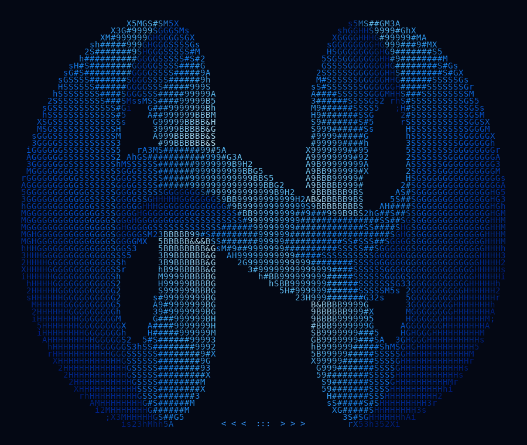

# LatentPort

**Hybrid composite models. Small-model prefill. Large-model generation. Programmable context.**

<p align="center">
  
</p>

[Website](https://latentport.com) · [Install](docs/installation.md) · [Cookbook](docs/cookbook.md) · [Models](https://huggingface.co/latentport) · [API](docs/api.md)


LatentPort lets one model inherit another model's working context. A learned bridge
translates the full hybrid inference state—attention K/V, recurrent memory,
convolution history and terminal hidden state—so the receiving model can continue
without rereading that context.

**LatentPort-4+27B** combines Qwen3.5-4B as the reader with Qwen3.8-27B as the generator.
The Python package makes the state something you can capture, translate, save, restore,
and branch. Composite inference is the first application of that interface.

```text
Your prompt → 4B reads → bridge translates state → 27B answers
                             ↓
                    save · reuse · branch
```

## What can you build?

- **Long-context assistants:** use the 4B for the initial prompt, then keep a fast cached conversation on the 27B.
- **A team working from one context:** prepare a repository or document once, translate it once, and give independent branches different questions.
- **Resumable workflows:** save complete model state, unload the models, and restore the context later.
- **Continuously growing context:** append new tool output or observations to a source state, then translate a snapshot when needed.

These are building blocks for your application. Forks are independent; the current
single-GPU runtime queues execution rather than running multiple agents simultaneously.

## Get started

**Preview target:** Windows x64, Python 3.11, NVIDIA RTX 5090 (32 GB), CUDA Toolkit 13.0
runtime libraries and a compatible NVIDIA driver. Other hardware is not yet qualified.
See the [installation guide](docs/installation.md) for prerequisites and troubleshooting.

Install the preview wheel in PowerShell (no repository clone or compiler needed):

```powershell
$env:LATENTPORT_HOME = 'F:\LatentPort\runtime' # choose a disk with ~40 GB free
py -3.11 -m venv "$env:LATENTPORT_HOME\venv"
& "$env:LATENTPORT_HOME\venv\Scripts\Activate.ps1"
python -m pip install torch==2.11.0 --index-url https://download.pytorch.org/whl/cu128
python -m pip install "https://huggingface.co/latentport/latentport-4-27b-research-preview-GGUF/resolve/main/runtime/latentport-0.1.0.dev1-py3-none-any.whl"
python -m latentport install-native
python -m latentport doctor
```

Run your first composite:

```python
import latentport as lp

with lp.load(backend="gguf") as port:
    port.warm()  # load once; keep the port alive across requests
    chat = port.composite.session()
    answer = chat.ask("Explain how a database index speeds up a query.")
    print(answer.text, end="", flush=True)
    while not answer.finished:
        answer = chat.generate(max_new_tokens=512)
        print(answer.text, end="", flush=True)
```

The first load downloads the pinned reader, target, bridge and tokenizer metadata
from Hugging Face (~22 GB of model/bridge files). Downloads are cached on your chosen
disk. `python -m latentport download` prepares them ahead of time. Have compatible
GGUFs already? Pass `source_path=` and `target_path=`; see [local files](docs/installation.md#use-existing-model-files).

## Telepathy for LLMs

Run `python examples/memory_transplant/server.py` for the [flagship browser demo](examples/memory_transplant/README.md):
a broken checkout, live 4B-to-27B state transfer, two specialist branches, and a
model-generated repair verified by executable tests.

## Watch your own TTFT comparison

Run `python examples/ttft_demo.py` to compare native 27B and LatentPort on a fresh
16K prompt, with live timers and a measured speedup. It warms both paths and pauses
so you can start recording. See the [demo guide](docs/ttft-demo.md).

Try the [live state demos](docs/state-demos.md) for cached conversations, two-specialist
branching, save/resume, and fresh-context updates. Each includes a visible task and
live model output.

## Two ways to run a conversation

| Policy | First prompt | Later user messages | Best fit |
| --- | --- | --- | --- |
| `cached_handoff` (default) | 4B reads; translate once; 27B generates | 27B appends only new input to retained state | Interactive conversations |
| `strict` (explicit) | 4B reads; translate; 27B generates | 4B incorporates the committed answer and new input; translate again | Keep every user prompt on the 4B |

Neither policy replays translated history through the target. Cached handoff deliberately
lets the target process **new** user messages. Complete an answer before asking the next
question; `generate()` resumes an answer that hit its token cap.

## One context, different questions

```python
# Inside a loaded port:
context = port.source.capture([("user", "Repository context: ...")])
shared = port.bridge.translate(context)
review, optimize = port.target.session(shared).fork(2)

security = review.ask("Find the most important security risk.")
performance = optimize.ask("Find the most important performance bottleneck.")
```

Each branch inherits the context and processes its own new question. The shared snapshot
is immutable. [The cookbook](docs/cookbook.md) covers completion, persistence, multi-turn
chat, streaming and MTP.

## Composite results

The frozen LatentPort-4+27B bridge was evaluated against both native models in E120.
The 4B reads the **entire prompt, including the question**; the 27B processes **zero prompt tokens**.

| Completed tasks | Native 4B | LatentPort-4+27B | Native 27B |
| --- | ---: | ---: | ---: |
| Panel A (64 tasks) | 9 / 64 | **26 / 64** | 29 / 64 |
| Independent confirmation B (64 tasks) | 11 / 64 | **23 / 64** | 29 / 64 |

On confirmation B, the composite improved strict task success by **18.75 percentage points**
over native 4B (paired 95% interval: +0.74 to +33.92 points). Native 27B remained stronger overall.
These are adapted public and authored tasks, not official leaderboard scores.

### Time to first token

| Prompt length | Native 27B median | Composite median | Paired TTFT speedup (95% CI) |
| --- | ---: | ---: | ---: |
| Short | 0.603 s | 0.513 s | 1.06x (0.87–1.29) |
| ~2K | 2.148 s | 1.295 s | **1.65x** (1.61–1.69) |
| ~8K | 8.871 s | 4.459 s | **2.01x** (1.96–2.05) |
| ~16K | 24.663 s | 11.087 s | **2.19x** (2.15–2.23) |

Across all 32 requests, paired TTFT speedup was **1.67x** (95% CI: 1.49–1.86).
Eight independent requests per length, three paired timing repetitions per request;
ratios are paired geometric estimates, not ratios of the displayed medians.

**Configuration:** RTX 5090, pinned NF4/BF16 research runtime, resident models and bridge.
TTFT includes source prefill, state translation, installation and first emitted token;
it excludes cold loading. A first emitted token may be a reasoning/control token, not
useful answer text. These results do not establish faster full answers or decode throughput.
Quality scores have not been re-established for the GGUF runtime. Prose grading was
identity-blinded AI grading; template differences and ambiguous judgments limit generalization.

Full values and source fingerprints: [composite-results.json](docs/composite-results.json).
See [benchmark notes](docs/benchmarks.md) for methodology and the separate GGUF runtime checks.

## Runtime support

| Component | Preview status |
| --- | --- |
| Windows x64 / RTX 5090 / Q4_K_M | Qualified with bounded real-model checks |
| Text input / greedy generation | Supported; vision, audio and sampling are outside this preview |
| Initial full-state handoff | Tested; zero target prompt processing |
| Strict and cached-handoff multi-turn | Tested on a 16K two-turn fixture |
| Save/restore, immutable snapshots and branching | Runtime correctness checked |
| Target MTP | Greedy accepted/rejected-draft and rollback checks passed |
| Linux, macOS, other GPUs and quantizations | Not qualified |
| vLLM integration / distributed serving | Not implemented |

The native download is a pinned **LatentPort-enabled llama.cpp** build. Stock llama.cpp
cannot install the translated hybrid state. The bridge GGUF holds FP32 translator
weights; it is not a standalone language model or a Q4-quantized bridge.

The package also exposes an experimental live `escalate()` primitive. It is not part
of the qualified composite research release or the results above. See [API scope](docs/api.md).

## Learn more and contribute

- [Installation and troubleshooting](docs/installation.md)
- [Recipes: chat, shared context, persistence, streaming and MTP](docs/cookbook.md)
- [API and state semantics](docs/api.md)
- [Benchmarks and what they measure](docs/benchmarks.md)
- [Native integration and source builds](docs/native-abi.md)
- [Contributing](CONTRIBUTING.md)

Report reproducible issues at [GitHub Issues](https://github.com/LatentPort/latentport/issues).
Include `python -m latentport doctor`, model file identities and a minimal example;
remove private prompts and credentials. The preview currently supports one directional
model pair. More bridges can extend the same state interface; arbitrary model pairs
and state merging are not supported today.

## License

The runtime and LatentPort bridge weights are Apache-2.0. Qwen model weights retain
their upstream Apache-2.0 licenses; llama.cpp retains its MIT license. See [LICENSE](LICENSE)
and the notices distributed with the native and model downloads.
