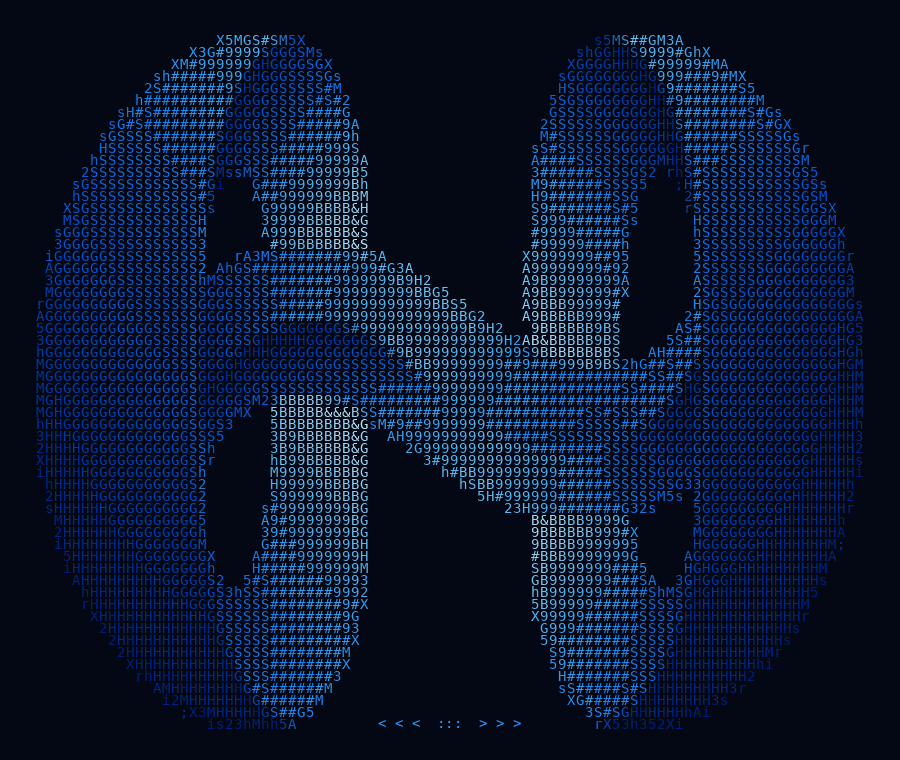

# LatentPort

**LatentPort makes LLM internal states programmable.**

**Created by [Simon P. Villani](https://au.linkedin.com/in/simon-villani).**

Capture a model's working memory as a reusable snapshot. Use it to continue
inference, transfer memory to a compatible model, compact attention memory,
combine contexts, or branch and save state for later use.

<p align="center">
  
</p>

[Website](https://latentport.com) | [Get started](#get-started) | [State operations](#state-operations) | [Supported transformations](#supported-transformations) | [vLLM](integrations/vllm/README.md) | [Cookbook](docs/cookbook.md) | [API](docs/api.md)


[](https://pypi.org/project/latentport/)

## Get started

Install the base package with Python 3.11 or later.

```shell
python -m pip install latentport
```

The example uses BF16. After setting up CUDA-enabled PyTorch and the CUDA build
environment, install the backend and check readiness. Platform requirements and
other backend options are in the [installation guide](docs/installation.md).

```shell
python -m pip install --no-build-isolation "latentport[bf16]"
latentport doctor --backend bf16
```

Read a prompt into working memory and use the snapshot to start a session.
LatentPort downloads the pinned model on first use if needed. Set
`LATENTPORT_HOME` to choose its cache directory.

```python
import latentport as lp

with lp.load_model("Qwen/Qwen3.5-4B", backend="bf16") as model:
    state = model.capture([("user", "The ticket is red.")])
    with model.session(state) as session:
        print(session.ask("What color is the ticket?").text)
```

## State operations

| Operation | API | Purpose |
| --- | --- | --- |
| [Capture](#get-started) | `model.capture(context)` | Read context into a reusable inference snapshot. |
| [Transfer](#transfer-working-memory) | `bridge.translate(state)` | Translate a snapshot for a compatible target model without replaying the source context. |
| [Compact](#compact-working-memory) | `state.compact()` | Reduce the attention key/value (KV) storage used by a snapshot. |
| [Combine](docs/api.md#combine) | `model.combine(left, right)` | Continue the left state by replaying the right context. |
| [Append](docs/cookbook.md#append-new-observations) | `model.append(state, text)` | Process new input from an existing state. |
| [Fork](docs/cookbook.md#prepare-once-branch-into-different-tasks) | `state.fork(2)` | Create independent branches that share immutable snapshot storage. |
| [Save / load](docs/cookbook.md#save-context-and-resume-later) | `state.save(path)` / `lp.State.load(path)` | Persist and restore a snapshot without reading the original prompt again. |

Snapshots record the exact model and runtime that created them. They contain
prompt-derived tensors and conversation text, so protect them like the original
conversation. [State ownership and persistence](docs/api.md#memory-and-ownership)

## Transfer working memory

[LPBridge quickstart and supported model pairs](https://latentport.com/lpbridge).

A bridge lets the target model continue from the source model's working memory.
Pass the bridge repository to `lp.load()` to select the model pair.
[Supported bridges](#supported-transformations)

```python
import latentport as lp

with lp.load("latentport/LPBridge-Qwen3.5-4b-Qwen3.5-9b", backend="bf16") as port:
    state = port.source.capture([("user", "The ticket is red.")])
    transferred = port.bridge.translate(state)
    with port.target.session(transferred) as session:
        print(session.ask("What color is the ticket?").text)
```

## Compact working memory

[LPCompact quickstart and benchmarks](https://latentport.com/lpcompact).

LPCompact uses a learned selector to reduce attention KV storage while preserving
original token positions, recurrent state and convolution state. After capturing
a long history, compact its snapshot and continue with the same open model.

```python
compacted = state.compact()
with model.session(compacted) as session:
    print(session.ask("What should we do next?").text)
```

By default, compaction retains one eighth of attention KV once the snapshot has
at least 65,536 retained positions. [Compaction guide](docs/compaction.md)

### Serve LPCompact with vLLM

All seven supported LPCompact base model profiles accept **BF16, NF4, and GGUF
weights** in vLLM. BF16 is the default in the stock NVIDIA image. NF4 and GGUF
require additional plugins and are experimental, with GPU qualification
pending. All three formats use BF16 compute and a BF16 KV cache. The L40S
benchmarks used BF16 weights.
[vLLM setup and model profiles](integrations/vllm/README.md)

## Supported transformations

Each bridge is directional and requires dense source state with complete alignment
metadata. Its model card specifies supported checkpoints, backends and transfer
boundaries.

| Source model | Target model | Bridge repository |
| --- | --- | --- |
| Qwen3.5-4B | Qwen3.5-9B | [`latentport/LPBridge-Qwen3.5-4b-Qwen3.5-9b`](https://huggingface.co/latentport/LPBridge-Qwen3.5-4b-Qwen3.5-9b) |
| Qwen3.5-4B | Qwen3.8-27B | [`latentport/LPBridge-Qwen3.5-4b-Qwen3.8-27b`](https://huggingface.co/latentport/LPBridge-Qwen3.5-4b-Qwen3.8-27b) |

For compaction, pass the base model ID to `lp.load_model()`. The runtime matches
the selector to the snapshot. For combination, pass an LPCombine profile ID to
`lp.load_model()` and use two snapshots from the same model and runtime. All six
profiles support retained-token replay with BF16, NF4 and GGUF. Cache-only replay
(`method="cache"`) depends on the profile and backend.

| Base model ID | LPCompact selector | LPCombine profile ID | LPCombine cache-only backends |
| --- | --- | --- | --- |
| `Qwen/Qwen3.5-4B` | [LPCompact-Qwen3.5-4B](https://huggingface.co/latentport/LPCompact-Qwen3.5-4B) | [`latentport/LPCombine-Qwen3.5-4B`](https://huggingface.co/latentport/LPCombine-Qwen3.5-4B) | BF16, NF4 |
| `Qwen/Qwen3.5-9B` | [LPCompact-Qwen3.5-9B](https://huggingface.co/latentport/LPCompact-Qwen3.5-9B) | [`latentport/LPCombine-Qwen3.5-9B`](https://huggingface.co/latentport/LPCombine-Qwen3.5-9B) | BF16, NF4 |
| `Qwen/Qwen3.8-27B` | [LPCompact-Qwen3.8-27B](https://huggingface.co/latentport/LPCompact-Qwen3.8-27B) | [`latentport/LPCombine-Qwen3.8-27b`](https://huggingface.co/latentport/LPCombine-Qwen3.8-27b) | NF4 |
| `Qwen/Qwen3.8-Flash-Next` | [LPCompact-Qwen3.8-Flash-Next](https://huggingface.co/latentport/LPCompact-Qwen3.8-Flash-Next) | [`latentport/LPCombine-Qwen3.8-Flash-Next`](https://huggingface.co/latentport/LPCombine-Qwen3.8-Flash-Next) | BF16 |
| `google/gemma-4-31B-it` | [LPCompact-Gemma-4-31B-it](https://huggingface.co/latentport/LPCompact-Gemma-4-31B-it) | [`latentport/LPCombine-Gemma-4-31B-it`](https://huggingface.co/latentport/LPCombine-Gemma-4-31B-it) | BF16 |
| `Qwen/Qwen3-14B` | [LPCompact-Qwen3-14B](https://huggingface.co/latentport/LPCompact-Qwen3-14B) | [`latentport/LPCombine-Qwen3-14B`](https://huggingface.co/latentport/LPCombine-Qwen3-14B) | BF16 |
| `Qwen/Qwen3.6-35B-A3B` | [LPCompact-Qwen3.6-35B-A3B](https://huggingface.co/latentport/LPCompact-Qwen3.6-35B-A3B) (BF16, NF4, GGUF) | — | — |

For a standalone GGUF model, pass the file as `model_path`. For split
checkpoints, keep the shards together and pass the first file. Runtime
requirements depend on the model and operation.
[Compaction compatibility](docs/compaction.md#supported-weights) · [Combination API](docs/api.md#combine)

## Validation and performance

Published measurements describe specific checkpoints, hardware and workloads.

- **Transfer.** The historical resident 4B-to-27B test measured a 2.19x paired
  time-to-first-token speedup at approximately 16K tokens against the native 27B
  model. [Methodology](docs/benchmarks.md) · [Results](docs/composite-results.json)
- **Compact.** At 128K context, 8x compaction reduced attention KV from 4 GiB to
  512 MiB on Qwen3.5-4B/9B and from 8 GiB to 1 GiB on Qwen3.8-27B.
  [Compaction results](docs/lpcompact-qwen35-validation.json) · [Backend validation](docs/compaction-validation.json)

## Demos and documentation

- Chat through a supported bridge with the [chat example](examples/chat.py).
- Query two saved snapshots with the [combination example](examples/combine.py).
- Set up the native or Docker browser demo with the [installation guide](docs/installation.md).
- Try context transfer, specialist branches and repair checks in the [memory transplant demo](examples/memory_transplant/README.md).
- Explore cached conversations, branching, persistence and append in the [state demos](docs/state-demos.md).
- Find usage recipes and backend contracts in the [cookbook](docs/cookbook.md) and [API reference](docs/api.md).
- [Native integration](docs/native-abi.md) and [contributing](CONTRIBUTING.md).

Report reproducible issues at [GitHub Issues](https://github.com/LatentPort/latentport/issues).
Include `python -m latentport doctor`, exact model identities and a minimal example
with private prompts and credentials removed.

## Project

LatentPort is an independent AI research project. It began with a September 2026
paper, [LatentPort: Beyond KV Cache](https://arxiv.org/abs/2609.25053).
Research directions include learned optimisation, combination and automatic
policy selection.

[Original research code](https://github.com/mmprotest/latentport-paper) |
[Transformation models](https://huggingface.co/latentport) |
[Python package](https://pypi.org/project/latentport/)

## License

The LatentPort runtime and transformation weights are Apache-2.0. Base models
retain their upstream licenses, and llama.cpp retains its MIT license. See
[LICENSE](LICENSE) and the notices supplied with model and native downloads.
